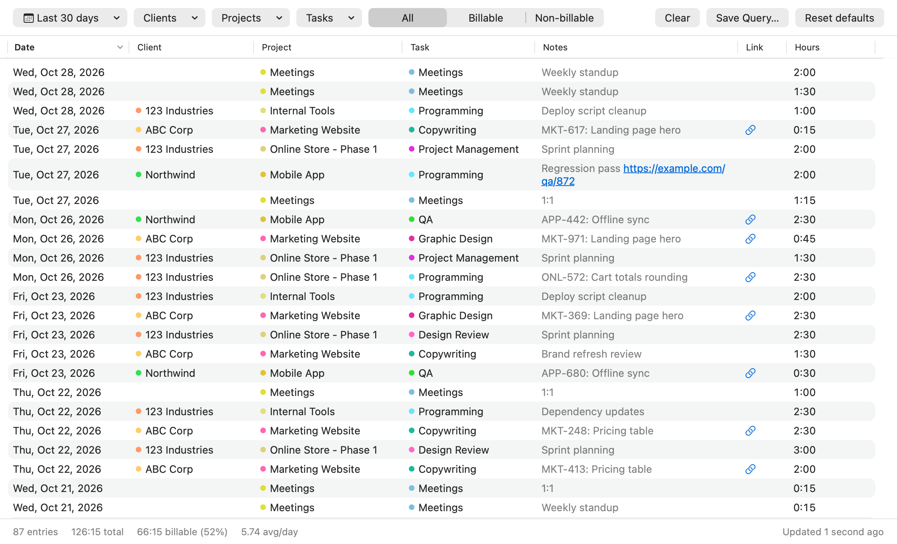
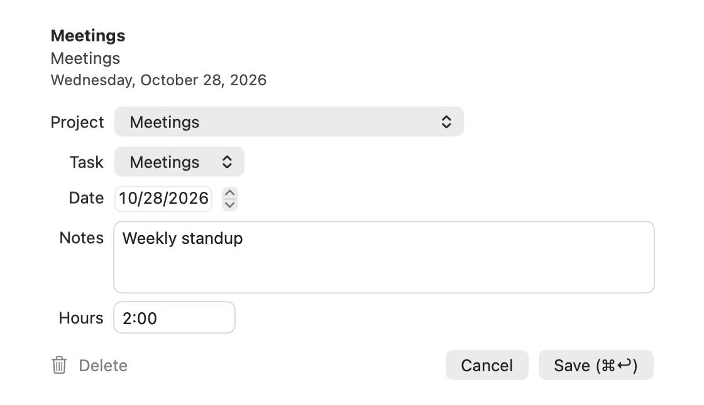
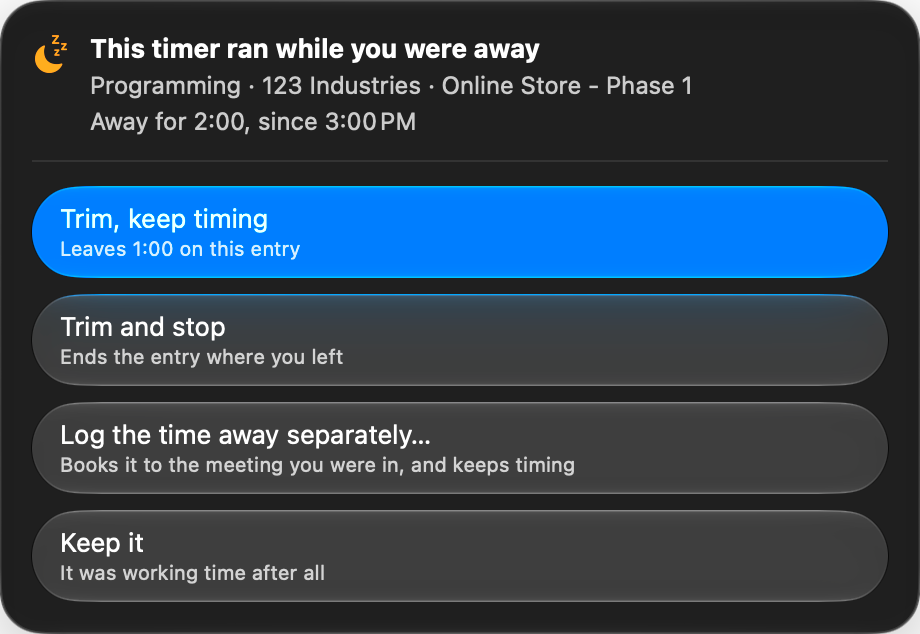

# Scythe

[](https://github.com/mxttbennett/scythe/actions/workflows/build.yml)

A native macOS client for [Harvest](https://www.getharvest.com). Track time from the menu bar, browse and edit your history, review analytics, and fill a weekly timesheet. Scythe began as a copy of [rainhead/sheaves](https://github.com/rainhead/sheaves) by Peter Abrahamsen; it retains the MIT license and project history.

## Screenshots






| Light | Dark |
| --- | --- |
|  |  |

## Install

Download the latest [release](https://github.com/mxttbennett/scythe/releases), unzip it, and move `Scythe.app` to `/Applications`. Releases are ad-hoc signed, so remove quarantine once before opening:

```sh
xattr -dr com.apple.quarantine /Applications/Scythe.app
```

Scythe requires macOS 26 or later. To build from source, install Xcode 26 or later and [xcodegen](https://github.com/yonaskolb/XcodeGen), then run:

```sh
xcodegen generate
xcodebuild -project Scythe.xcodeproj -scheme Scythe -destination 'platform=macOS' build
```

## Use

- Click the menu bar play/pause icon to start or stop a timer; click the entry text to open the panel.
- In the panel, press **E** or **Return** to edit the selected entry; **S** or **Space** starts or stops it. **⌘N** adds an entry.
- Open Explorer with **⌘1**, Analytics with **⌘2**, or Timesheet with **⌘3**.
- Press **⌃⌥⌘T** in any app to search for a project or task and start a timer.
- The editor supports changing an entry’s date, clicking outside to close, and **⌘Return** to save.

Connect an account by creating a personal access token at [Harvest Developers](https://id.getharvest.com/developers) and entering it with your account ID in Scythe’s settings. The token stays in the macOS Keychain and is sent only to Harvest.

## Design

Scythe updates local state immediately and syncs changes through a persistent, ordered queue. If a request fails, queued edits wait for reconnection. Calendar dates stay timezone-free to match Harvest’s `spent_date`, and history, filters, totals, and charts work from a local two-year copy.

The app is sandboxed. Its snapshots, pending edits, history, and saved queries live under:

```text
~/Library/Containers/com.mxttbennett.scythe/Data/Library/Application Support/Scythe/
```

Run the test suites with:

```sh
swift test --package-path Packages/ScytheCore
xcodebuild -project Scythe.xcodeproj -scheme Scythe -destination 'platform=macOS' test
```

## Project layout

- [`Packages/ScytheCore`](Packages/ScytheCore): Harvest API, models, offline queue, history, analytics, and CSV export.
- [`Apps/Mac`](Apps/Mac): macOS menu bar, desktop, settings, and quick-entry views.
- [`Scripts`](Scripts): release packaging and documentation image rendering.
- [`docs`](docs): design notes and screenshots.

Scythe needs no Developer account to build locally. Releases are ad-hoc signed; signing and notarization require an Apple Developer ID.
