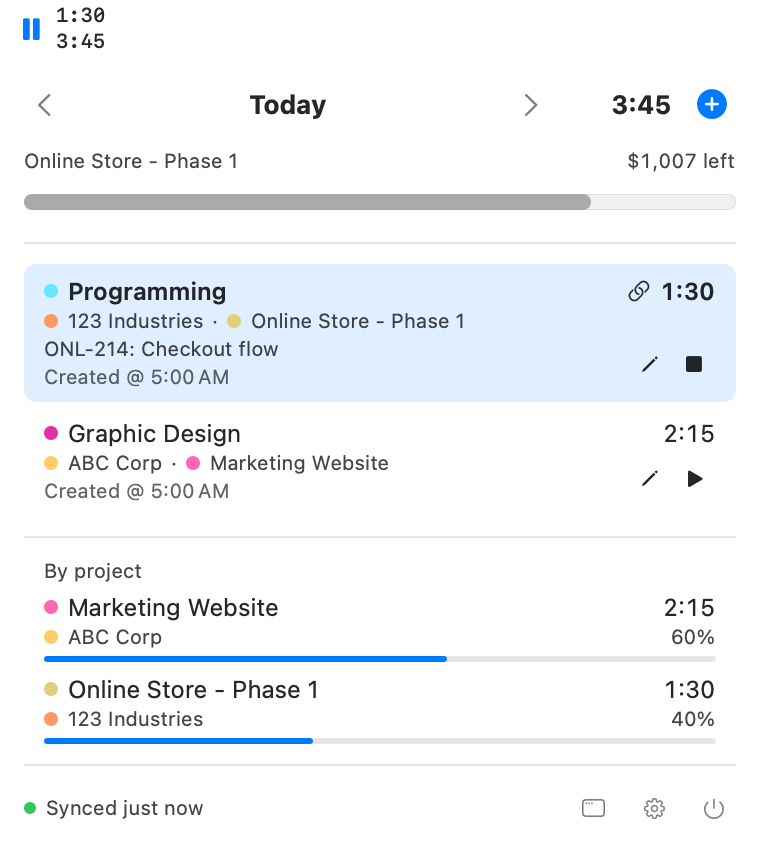
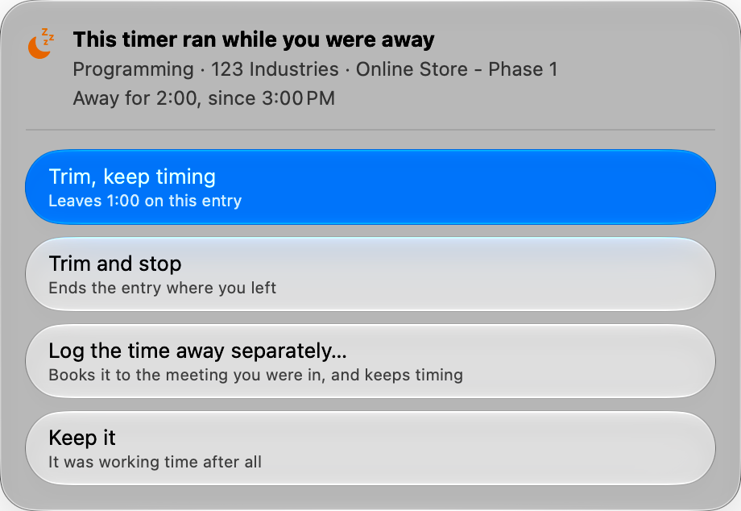

# Scythe

[](https://github.com/mxttbennett/scythe/actions/workflows/build.yml)

A native macOS menu bar and desktop client for [Harvest](https://www.getharvest.com) time tracking.

Scythe began as a copy of [rainhead/sheaves](https://github.com/rainhead/sheaves) by Peter
Abrahamsen, which is MIT licensed, and keeps its history.

## What it does

- The clock you are on stays in the menu bar. One click pauses or resumes it, and the item can show the icon alone, the icon and time, or the icon with project and time.
- The menu bar panel lists the day's entries and breaks the day down by project. Press ⌘N to add an entry by hand or start a timer, and press ⌘+ or ⌘− to resize the panel.
- The desktop window (⌘1) has an explorer with search, filters, editing and CSV export, an analytics dashboard and a weekly timesheet, all over a local copy of your last two years of entries.
- Entries logged from a tool such as Linear carry a link icon that opens the ticket, in the Linear desktop app when it is installed.
- ⌃⌥⌘T starts a timer from any app.
- When a timer ran with nobody at the Mac, Scythe offers to trim the time. A call is not being away, so it stays quiet through Zoom and Meet.
- Nothing blocks on the network. Scythe shows local state immediately and reconciles with Harvest afterwards.



## Status

Early, and built for one person's use. The macOS app is the only app. iOS is not built,
but everything except the views lives in a platform-neutral package so it can be.

Scythe needs macOS 26 or later, and Xcode 26 or later to build it.

## Installing

Download the newest zip from [Releases](https://github.com/mxttbennett/scythe/releases),
unpack it, and move `Scythe.app` to `/Applications`.

macOS will refuse to open it. Releases are signed *ad-hoc* rather than with a
Developer ID, and Gatekeeper does not accept an ad-hoc signature from the internet —
so it has to be told, once, that this one is wanted:

```sh
xattr -dr com.apple.quarantine /Applications/Scythe.app
```

An ad-hoc signature also changes with every build, so macOS treats each release as a
different app and asks again for Keychain access to your Harvest token. Both costs go
away with a Developer ID certificate and notarisation, which needs the paid Apple
Developer Program membership described under [Building it](#building-it).

## Building it

```sh
brew install xcodegen     # the .xcodeproj is generated, not committed
xcodegen generate
open Scythe.xcodeproj
```

The project signs ad-hoc, so a fresh checkout builds and runs with no Apple
Developer account. The catch is that an ad-hoc signature changes with every build,
so macOS treats each rebuild as a different app and re-prompts for the Keychain item
holding your token. To stop that, copy
[`Config/Local.example.xcconfig`](Config/Local.example.xcconfig) to
`Config/Local.xcconfig` (git-ignored) and fill in your team ID. A **free** Apple ID
is enough — the $99 Developer Program is for distribution, not for running your own
app on your own Mac.

```sh
swift test --package-path Packages/ScytheCore              # core logic
xcodebuild -project Scythe.xcodeproj -scheme Scythe \
  -destination 'platform=macOS' test                        # app logic
```

The core suite is the bulk of it. The app suite exists because the parts that only
compile against AppKit had no tests at all, and that is where the worst bugs turned
up — a shortcut recorder that trapped on every key press, and a missing main menu
that made ⌘V silently do nothing.

A release is cut by bumping `MARKETING_VERSION` in [`project.yml`](project.yml) and
pushing a matching `v` tag.
[`Scripts/package-release.sh`](Scripts/package-release.sh) builds and zips the app,
and [the release workflow](.github/workflows/release.yml) runs that same script after
the tests pass — refusing any tag that disagrees with the version the built app
reports.

## Connecting to Harvest

Create a personal access token at
[id.getharvest.com/developers](https://id.getharvest.com/developers) and paste it,
with the account ID shown beside it, into Scythe's settings. The token is stored in
the Keychain and sent only to `api.harvestapp.com`.

Settings has a switch to open Scythe at login, which registers the bundle where it
sits right now — move the app and the switch has to go off and on again to point at
the new location.

Scythe is sandboxed, so its files live in
`~/Library/Containers/com.mxttbennett.scythe/Data/Library/Application Support/Scythe/`:
`snapshot.json` (the last known day), `pending-mutations.json` (changes waiting to
reach Harvest), `history.json` (the two-year copy) and `saved-queries.json`. Deleting
`history.json` makes the next refresh rebuild the copy from Harvest.

## How it works

Three ideas carry most of the design.

**A day is not a moment.** Harvest's `spent_date` is a date with no time zone, and
round-tripping it through `Date` puts entries on the wrong day for anyone east or
west of wherever the conversion happened. [`CalendarDate`](Packages/ScytheCore/Sources/ScytheCore/Model/CalendarDate.swift)
keeps days as days and only becomes a `Date` against an explicit calendar.

**Time is recorded, not re-measured.** Harvest's `/stop` banks time up to the moment
the request *arrives*, and a create starts its timer on arrival too — so replaying
bare commands after a spell offline destroys or invents hours in equal measure. Every
[`Mutation`](Packages/ScytheCore/Sources/ScytheCore/Store/MutationQueue.swift) that
affects elapsed time carries the time the user acted and sends explicit hours, so an
entry is honest however late the request lands.

**Local state is the truth until a sync succeeds.** Every action — start, stop,
resume, edit — changes [`TimeTracker`](Packages/ScytheCore/Sources/ScytheCore/Store/TimeTracker.swift)
first and reaches Harvest second, through a persisted
[`MutationQueue`](Packages/ScytheCore/Sources/ScytheCore/Store/MutationQueue.swift).
The queue drains in order and stops at the first failure a retry could fix, so a
dropped connection costs nothing; a change Harvest refuses outright is dropped rather
than left to wedge everything behind it. An entry started offline has no Harvest id
yet, which is why [`TrackedEntry`](Packages/ScytheCore/Sources/ScytheCore/Model/TrackedEntry.swift)
identity is either a server id or a local one, swapped when the create lands. The
queue remembers which account and user filled it: a renewed token for the same person
sends what was waiting, and anyone else is asked before it is discarded, never sent.

**Syncing is event-driven, plus a probe for everyone else's edits.** Every action
syncs on the spot, and opening the panel does too — so a background probe exists
only to catch changes made outside this app, like the web timesheet or a phone. Its
cadence follows whether you are working: outside edits land within about ten
seconds while a timer runs or has just stopped, an idle machine checks every
minute, and Low Power Mode stops the probe entirely. The cadence is
[`TimeTracker.probeInterval`](Packages/ScytheCore/Sources/ScytheCore/Store/TimeTracker+Probe.swift);
the Mac shell answers the power question through
[`PowerSource`](Apps/Mac/Sources/PowerSource.swift).

**The menu bar is a control, not a readout.** The status item shows a pause button
while a timer runs and a play button for 90 minutes after one stops, so the common
action costs one click and opens nothing; clicking the name opens the popover
instead. That is why [`StatusItemController`](Apps/Mac/Sources/StatusItemController.swift)
is hand-rolled AppKit — SwiftUI's `MenuBarExtra` has exactly one behaviour, which is
to open its content on any click. A running timer's glyph is drawn in the accent
colour, the way macOS says a menu bar extra is doing something, and colour is never
the only thing saying it: the three states already have three different symbols.

**Being on a call is not being away.** Idle detection that watches only the
keyboard and mouse interrupts every meeting to ask whether you are still there, and
Harvest's own app does exactly that. Scythe counts the microphone being in use as
presence — while you are muted too, which is the case that decides whether any of
this is worth having — so a call is time at work like any other. It asks whether a
device is running, never what it is carrying, so it needs no microphone entitlement
and prompts for no permission. A locked screen outranks it, and an absence only
speaks for a timer that was running while somebody was here: one started on the web
or a phone is left alone, because this Mac knows nothing about it.
[How Scythe decides you are here](docs/presence.md) has the measurements and the
limits.



**Suggestions are ranked by what you actually do.** Harvest returns every task on
every assigned project, alphabetically, burying the two or three things you do daily.
Scythe ranks them by 90 days of your own entries, weighted so the score halves every
three weeks: frequency alone pins a finished project to the top for weeks, recency
alone lets one stray entry outrank a habit.

**A budget appears only if there is one.** Harvest's project budget report answers
`budget_by: none` for a project that budgets nothing, and empty figures for a
monetary budget, which only administrators and managers holding the billable-rates
permission may read. On some accounts there is nothing to draw, and there is no
lesser version to fall back on — so
[`BudgetBar`](Apps/Mac/Sources/BudgetBar.swift) is absent rather than present and
empty, and a refusal is taken as a settled answer rather than retried. It is also
the one thing here on Harvest's Reports API, whose allowance is 100 requests per 15
*minutes* rather than per 15 seconds, so budgets refresh on a slow clock of their
own instead of riding every start and stop.

**The UI never waits to draw.** A JSON
[snapshot](Packages/ScytheCore/Sources/ScytheCore/Persistence/SnapshotStore.swift)
of the last known state is restored at launch, so the popover is populated before the
first request returns.

**The desktop window reads a local copy.** Its first refresh fetches two years of
entries in one request, and later refreshes ask only for what changed since the last
one (`updated_since`). Harvest does not report deleted entries that way, so the last 60
days are replaced wholesale each time. Filters, totals and charts run on that copy in
memory, so none of them wait on the network.
[`EntryHistory`](Packages/ScytheCore/Sources/ScytheCore/History/EntryHistory.swift)
holds it.

**Panels scale with real fonts.** ⌘+ and ⌘− change font sizes, spacing and frames
instead of stretching the drawn layout, which comes out soft on a Retina display.
[`ScaledUI`](Apps/Mac/Sources/ScaledUI.swift) has the helpers.

The global hotkey uses Carbon's `RegisterEventHotKey`
([`GlobalHotKey`](Apps/Mac/Sources/GlobalHotKey.swift)) rather than an `NSEvent`
monitor: it needs no Accessibility permission and can actually consume the key. It is
rebindable in Settings, and says so when another app already owns the combination —
Carbon reports that by failing silently, which is worth surfacing.

## Layout

| Path | What lives there |
| --- | --- |
| [`Packages/ScytheCore`](Packages/ScytheCore) | API client, models, offline queue, history, analytics and CSV. No AppKit, no SwiftUI. |
| [`Apps/Mac`](Apps/Mac) | The macOS app: menu bar panel, desktop window, quick-entry panel, settings, and the icon source. |
| [`project.yml`](project.yml) | Targets and build settings; the `.xcodeproj` is generated from it. |
| [`Scripts`](Scripts) | Jobs that need more than a line: the release package, the documentation images. |
| [`docs`](docs) | Notes too long for here, and the images this file uses. |

## Keyboard

Anywhere:

| | |
| --- | --- |
| ⌃⌥⌘T | Quick entry, from any app (rebindable in Settings) |
| Click ⏸ / ▶ in the menu bar | Pause or resume, without opening anything |

In the menu bar panel:

| | |
| --- | --- |
| ↑ ↓ | Move through the day's entries |
| ⏎ | Stop or resume the selected entry |
| ⌫ | Delete the selected entry, after asking |
| ✎ on an entry, or right-click it | Edit its notes or time, or delete it |
| ⌘← ⌘→ | Previous / next day |
| ⌘N | Add a time entry by hand. Leave the hours empty to start a timer instead |
| ⌘+ ⌘− ⌘0 | Make the panel larger or smaller, in steps of 10%, or back to full size |
| ⌘1 | Open the desktop window |
| ⌘, and ⌘Q | Settings and quit |

In the desktop window:

| | |
| --- | --- |
| ⌘N | Add a time entry by hand |
| ⌘R | Refresh from Harvest |

## Licence

MIT. See [LICENSE](LICENSE).
